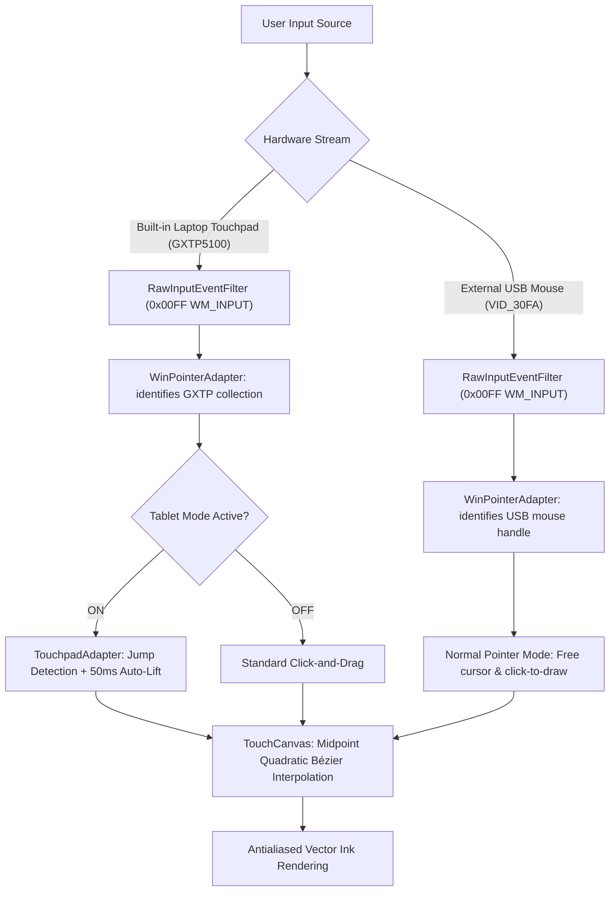

<div align="center">

# ✍️ TouchWrite

**Transform your Windows laptop touchpad into a natural digital writing tablet.**  
*Write seamlessly with one finger in real time — no stylus, no extra hardware, and no font conversion.*

[](https://www.python.org/)
[-41CD52?style=for-the-badge&logo=qt&logoColor=white)](https://pypi.org/project/PySide6/)
[](https://www.microsoft.com/windows)
[](https://github.com/Kumar-LLP/TouchWrite)
[](LICENSE)

[Features](#-key-features) • [How It Works](#-how-it-works) • [Installation](#-quick-start) • [Shortcuts](#-keyboard-shortcuts) • [Architecture](#-architecture) • [Testing](#-running-tests)

</div>

---

## 💡 The Vision

Have you ever wanted to jot down handwritten mathematical formulas, sign a PDF, draw diagrams, or take natural notebook notes on your Windows laptop without buying an expensive graphics tablet or touchscreen convertible?

Standard laptop touchpads are tuned only for cursor pointing. If an application attempts to draw on mouse movement, it either creates endless connected lines or requires stiff, uncomfortable physical clicks. 

**TouchWrite solves this fundamental engineering challenge.** Using low-level Windows Precision Touchpad (PTP) telemetry and intelligent stroke discrimination, TouchWrite turns your built-in laptop touchpad into an authentic, responsive writing surface — write with **one finger** just like writing with a pen on an iPad!

---

## ✨ Key Features

### 📱 True Single-Finger Tablet Mode
- **Effortless Inking**: Glide your index finger naturally across the touchpad surface to write letters, words, and sentences in real time.
- **External Mouse Isolation**: Connect an external USB/Bluetooth mouse simultaneously! While your touchpad acts as the writing surface, your external mouse acts 100% as an ordinary mouse pointer — click color swatches, change pen widths, select tools, and navigate menus without producing stray marks.
- **Fast Auto-Lift Timing (50 ms)**: When you lift your finger to move to the next word, the stroke commits instantly.
- **Spatial Jump Detection**: Crossing a `t`, dotting an `i`, or starting a new letter automatically breaks the stroke without drawing unwanted connecting lines across your writing.

### 🖋 Natural Handwriting Engine
- **Midpoint Quadratic Bézier Splines**: Raw coordinate points are smoothly interpolated into organic, mathematically continuous vector curves.
- **Velocity-Sensitive Dynamics**: Slower, deliberate strokes produce richer ink; rapid flourishes taper naturally, mirroring real fountain pen dynamics.
- **Zero Character Conversion**: Your handwriting remains **your handwriting**. Strokes are preserved in their authentic organic geometry instead of converting into typed font glyphs.

### 📓 Digital Notebook Environment
- **Paper Styles**: Toggle between **Ruled / Lined Paper**, **Engineering Grid / Graph Paper**, and clean **Blank Paper**.
- **Inking Studio**: Full pen thickness control (1–16 pt), quick-pick swatches (*Black, Navy, Crimson, Emerald, Purple, Amber, Graphite*), and custom RGB color picker.
- **Smart Stroke Eraser**: Tap or swipe over any stroke to erase entire paths cleanly.
- **Infinite Undo / Redo**: Complete history stack with standard `Ctrl+Z` / `Ctrl+Y` shortcuts.
- **Smooth Zoom & Pan**: Infinite virtual canvas navigation with viewport anchoring and fit-to-width mode.
- **Theme Modes**: Modern Dark and Light user interface themes.

### 💾 Session Storage & Multi-Format Vector Export
- **Vector JSON Sessions**: Save and resume your work with full vector stroke fidelity and metadata.
- **High-DPI PNG**: Export crisp raster images with options for transparent background and auto-cropping to content.
- **Scalable Vector Graphics (SVG)**: Export vector paths compatible with Inkscape, Illustrator, Figma, and web browsers.
- **Print-Ready PDF**: Export directly into multi-page or single-page PDF notebook sheets with vector paths intact.

---

## 🔬 How It Works

Windows 11 categorizes laptop touchpads as Precision Touchpads (PTP). Under the hood, TouchWrite implements a native Windows RawInput subsystem to separate hardware streams:



### Hardware Discrimination
On laptops like the **Lenovo LOQ** (equipped with Goodix Precision Touchpads `GXTP5100`), Windows generates pointing collections for both the touchpad and any connected external USB mouse (`VID_30FA`). TouchWrite registers `RAWINPUTDEVICE` hooks and inspects the device handles via `GetRawInputData` in 64-bit space, automatically separating finger gestures on the touchpad from external mouse navigation.

---

## 🚀 Quick Start

### Prerequisites
- **Operating System**: Windows 11 or Windows 10 (64-bit recommended).
- **Hardware**: Laptop with a built-in Precision Touchpad (Goodix, Synaptics, ELAN, ALPS, etc.).
- **Python**: Python 3.10, 3.11, 3.12, 3.13, or 3.14.

### 1. Clone the Repository
```bash
git clone https://github.com/Kumar-LLP/TouchWrite.git
cd TouchWrite
```

### 2. Install Dependencies
```bash
pip install -r requirements.txt
```

### 3. Launch the Application
Double-click **`run.bat`** or run:
```bash
python main.py
```

---

## ⌨️ Keyboard Shortcuts

| Shortcut | Action | Description |
| :--- | :--- | :--- |
| <kbd>T</kbd> | **Toggle Tablet Mode** | Switch between Single-Finger Tablet Inking and standard mouse mode |
| <kbd>P</kbd> | **Pen Tool** | Activate smooth vector handwriting pen |
| <kbd>E</kbd> | **Eraser Tool** | Activate stroke-based eraser |
| <kbd>H</kbd> | **Pan Tool** | Activate hand tool to pan paper canvas |
| <kbd>Ctrl</kbd> + <kbd>Z</kbd> | **Undo** | Undo last stroke or erase operation |
| <kbd>Ctrl</kbd> + <kbd>Y</kbd> | **Redo** | Redo previously undone operation |
| <kbd>Ctrl</kbd> + <kbd>S</kbd> | **Save Session** | Save vector session to `.touchwrite` JSON file |
| <kbd>Ctrl</kbd> + <kbd>O</kbd> | **Open Session** | Open saved notebook session |
| <kbd>Ctrl</kbd> + <kbd>E</kbd> | **Export** | Export handwriting to PNG, SVG, or PDF |
| <kbd>Ctrl</kbd> + <kbd>+</kbd> | **Zoom In** | Magnify notebook canvas |
| <kbd>Ctrl</kbd> + <kbd>-</kbd> | **Zoom Out** | Reduce canvas magnification |
| <kbd>Ctrl</kbd> + <kbd>0</kbd> | **Reset View** | Reset zoom to 100% |
| <kbd>Space</kbd> *(Hold)* | **Hold-to-Write** | Secondary optional two-handed writing trigger |

---

## 📁 Project Structure

```text
TouchWrite/
├── main.py                     # Application entry point with UTF-8 Windows runtime
├── run.bat                     # Windows one-click desktop launcher
├── requirements.txt            # Dependency declarations (PySide6, pytest)
├── LICENSE                     # MIT Open Source License
├── README.md                   # Project documentation and guide
│
├── touchwrite/                 # Core TouchWrite package
│   ├── config.py               # Application configuration and persistence
│   │
│   ├── canvas/                 # Drawing canvas & rendering subsystem
│   │   ├── canvas.py           # Interactive TouchCanvas with viewport pan/zoom
│   │   ├── history.py          # Command pattern undo/redo stack
│   │   ├── paper.py            # Ruled, Grid, and Blank paper rendering
│   │   ├── renderer.py         # Midpoint quadratic Bézier antialiased ink engine
│   │   └── stroke.py           # Vector stroke geometry, bounding boxes, hit-testing
│   │
│   ├── input/                  # Modular input adapter subsystem
│   │   ├── base.py             # Abstract BaseInputAdapter interface
│   │   ├── manager.py          # Central input coordinator & device arbiter
│   │   ├── mouse_adapter.py    # Standard mouse fallback adapter
│   │   ├── tablet_adapter.py   # Windows Ink stylus & tablet adapter
│   │   ├── touchpad_adapter.py # Precision Touchpad single-finger tablet engine
│   │   └── win_pointer_adapter.py # Windows RawInput (WM_INPUT) & PTP telemetry
│   │
│   ├── storage/                # Document session persistence
│   │   ├── json_format.py      # Vector stroke serialization format
│   │   └── session_manager.py  # Session lifecycle & dirty tracking
│   │
│   ├── export/                 # High-resolution multi-format exporters
│   │   ├── image_export.py     # PNG exporter with transparency & crop
│   │   ├── pdf_export.py       # Print-ready vector PDF exporter
│   │   └── svg_export.py       # Scalable Vector Graphics exporter
│   │
│   └── ui/                     # PySide6 desktop user interface
│       ├── calibration_dialog.py # Hardware testing & input diagnostics dialog
│       ├── export_dialog.py    # Format selection and resolution settings dialog
│       ├── main_window.py      # Main application window & menu bar
│       ├── settings_dialog.py  # Input modes, lift timers, paper preferences
│       ├── status_widget.py    # Real-time inking badge & telemetry widget
│       ├── theme.py            # Modern Dark and Light themes
│       └── toolbar.py          # Ribbon toolbar with Tablet Mode toggle & swatches
│
└── tests/                      # Automated test suite (29 tests)
    ├── test_canvas.py          # Canvas interaction, pan, and zoom tests
    ├── test_chatgpt_workflow.py# End-to-end letter writing verification (C-h-a-t-G-P-T)
    ├── test_export.py          # PNG, SVG, and PDF file export tests
    ├── test_input.py           # Hardware discrimination, jump detection, lift timer
    ├── test_storage.py         # JSON session save and load verification
    ├── test_stroke.py          # Bézier spline geometry and hit-testing
    └── test_ui_and_paper.py    # Paper rendering and UI component lifecycle
```

---

## 🧪 Running Tests

TouchWrite includes a thorough test suite verifying all canvas operations, spline mathematics, export pipelines, and hardware input adapters:

```bash
python -m pytest tests/
```

Output:
```text
============================= test session starts =============================
platform win32 -- Python 3.14.5, pytest-9.2.0, pluggy-1.7.0
collected 29 items

tests/test_canvas.py ......                                              [ 20%]
tests/test_chatgpt_workflow.py .                                         [ 24%]
tests/test_export.py ...                                                 [ 34%]
tests/test_input.py ........                                             [ 62%]
tests/test_storage.py ....                                               [ 75%]
tests/test_stroke.py .....                                               [ 93%]
tests/test_ui_and_paper.py ..                                            [100%]

============================== 29 passed in 1.00s =============================
```

---

## 🛠️ Diagnostics & Calibration

TouchWrite comes with a built-in **Hardware Calibration & Diagnostics** screen to verify your touchpad and pointer capabilities:

1. Open **Settings** (<kbd>Ctrl</kbd> + <kbd>,</kbd>) or click **⚙ Settings** in the toolbar.
2. Click **Touchpad Diagnostics & Calibration**.
3. View real-time packet counts, detected device identifiers (`Goodix GXTP5100`), digitizer capabilities, and test your finger stroke velocity.

---

## 🤝 Contributing

Contributions, bug reports, and suggestions are welcome!
1. Fork the Project (`https://github.com/Kumar-LLP/TouchWrite/fork`)
2. Create your Feature Branch (`git checkout -b feature/NewFeature`)
3. Commit your Changes (`git commit -m 'Add NewFeature'`)
4. Push to the Branch (`git push origin feature/NewFeature`)
5. Open a Pull Request

---

## 📄 License

Distributed under the **MIT License**. See [`LICENSE`](LICENSE) for more information.

---

<div align="center">
  <sub>Built with ❤️ for Windows 11 by <a href="https://github.com/Kumar-LLP">Kumar-LLP</a></sub>
</div>
